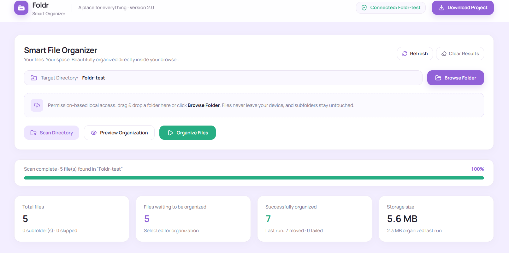

# Foldr – Smart File Organizer

**A place for everything.**

Foldr is a browser-based smart file organizer designed to simplify file management. It scans user-selected folders, identifies file types, previews organization plans, and automatically sorts files into structured categories.

## Preview


## Features

- **Smart File Classification:** Automatically identifies files using their extensions.
- **Folder Scanning:** Scans user-selected directories through browser permissions.
- **Organization Preview:** Displays proposed file destinations before moving files.
- **Automated Sorting:** Organizes files into eight categories.
- **Duplicate Protection:** Handles filename conflicts to prevent accidental overwrites.
- **Privacy-Focused:** Processes files locally in the browser without uploading their contents to a server.
- **Modern Interface:** Clean, responsive interface with a premium lavender theme.

## File Categories

| Category | Examples |
|---|---|
| Documents | PDF, DOCX, TXT |
| Images | JPG, PNG, SVG |
| Videos | MP4, MKV, MOV |
| Audio | MP3, WAV, FLAC |
| Archives | ZIP, RAR, 7Z |
| Applications | EXE, MSI, APK |
| Spreadsheets | XLSX, CSV, XLS |
| Others | Unrecognized file types |

## Technology Stack

- React
- TypeScript
- Vite
- JavaScript
- Browser File System Access API
- CSS

## Getting Started

### Prerequisites
- Node.js
- npm
- Google Chrome or Microsoft Edge

### Installation

```bash
git clone https://github.com/yash43069-glitch/foldr-smart-file-organizer.git
cd foldr-smart-file-organizer
npm install
npm run dev
```

Open the local URL displayed in your terminal.

### Production Build

```bash
npm run build
```

## Privacy and Security

Foldr uses browser-based file system permissions. Users select the folders they want to organize and explicitly grant access.

Files are processed locally in the browser. They are not uploaded to a Foldr backend.

## Browser Compatibility

Designed for desktop browsers supporting the File System Access API, particularly Google Chrome and Microsoft Edge.

## Project Status

Core folder scanning, categorization, preview, and organization functionality have been tested locally.

## Author

**Yash Verma**

GitHub: https://github.com/yash43069-glitch

---

*Foldr – A place for everything.*
